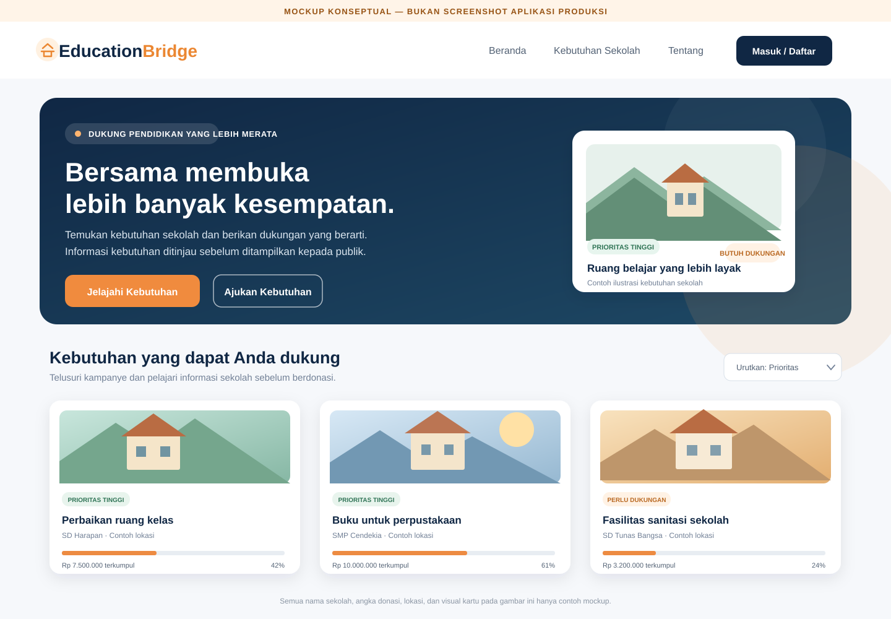

# PROPOSAL LOMBA WEB DEVELOPMENT

## IT FEST 2026

# EDUCATIONBRIDGE
### Platform Fundraising Digital untuk Pemerataan Akses Pendidikan di Wilayah 3T

**Disusun oleh:**  
[Nama Ketua Tim] · [Nama Anggota Tim]  
[Nama Perguruan Tinggi]  
2026

> **Catatan penyuntingan:** Ganti semua teks dalam tanda kurung siku dengan data final tim. Pastikan klaim implementasi, tautan, dan bukti pada proposal sesuai dengan aplikasi yang benar-benar dapat diuji.

---

## Ringkasan Eksekutif

Kebutuhan pendidikan sekolah tidak selalu mudah ditemukan dan dipahami oleh calon donatur. Di saat yang sama, informasi tentang kondisi sekolah, tingkat kebutuhan, target bantuan, dan penggunaan dana perlu disajikan secara jelas agar dukungan dapat diberikan dengan lebih terarah.

**EducationBridge** adalah aplikasi web yang mempertemukan sekolah atau pihak yang berwenang dengan calon donatur. Platform ini mendukung pengajuan kebutuhan, verifikasi sekolah dan pengajuan oleh admin, penelusuran kampanye, pencatatan donasi, serta penyediaan informasi perkembangan dan laporan yang tersedia. Informasi prioritas membantu pengguna membandingkan kebutuhan; penilaian tersebut perlu disertai indikator dan sumber data yang dapat dijelaskan.

Proposal ini menjelaskan masalah yang dituju, solusi dan alur pengguna, rancangan antarmuka, teknologi, serta rencana demonstrasi. Mockup yang disertakan merupakan **visualisasi rancangan**, sedangkan gambar pada bagian dokumentasi implementasi perlu diisi dengan tangkapan layar aplikasi aktual.

## 1. Pendahuluan

### 1.1 Latar Belakang

Pendidikan berperan penting dalam meningkatkan kualitas sumber daya manusia. Namun, sekolah di berbagai wilayah, termasuk wilayah tertinggal, terdepan, dan terluar (3T), dapat menghadapi keterbatasan sarana belajar, fasilitas sanitasi, akses teknologi, bahan bacaan, dan dukungan pembelajaran.

Calon donatur memerlukan informasi yang mudah diperiksa sebelum menentukan dukungan. Identitas sekolah, uraian kebutuhan, tingkat urgensi, target dana, perkembangan donasi, dan laporan penggunaan dana merupakan informasi penting untuk membangun kepercayaan. Tanpa proses verifikasi dan pelaporan yang tertata, informasi kebutuhan dapat sulit dibandingkan dan dipertanggungjawabkan.

EducationBridge dirancang untuk menghubungkan kebutuhan pendidikan dengan calon donatur melalui proses digital yang lebih terstruktur. Pengajuan diperiksa sebelum dipublikasikan, informasi prioritas membantu penelusuran kebutuhan, dan aktivitas penting dapat ditelusuri melalui pencatatan sistem.

### 1.2 Rumusan Masalah

1. Bagaimana sekolah atau pihak yang berwenang dapat menyampaikan kebutuhan pendidikan secara terstruktur?
2. Bagaimana calon donatur dapat menemukan kebutuhan yang relevan dan memahami statusnya?
3. Bagaimana proses verifikasi, donasi, dan pelaporan dapat dibuat lebih transparan?
4. Bagaimana kebutuhan dapat dibandingkan berdasarkan indikator prioritas yang dapat dijelaskan?

### 1.3 Tujuan

1. Memfasilitasi pengajuan kebutuhan pendidikan secara digital.
2. Mendukung verifikasi akun sekolah dan pemeriksaan pengajuan oleh admin.
3. Menyajikan informasi prioritas untuk membantu membandingkan kebutuhan.
4. Memudahkan calon donatur menelusuri kampanye, membaca detail, dan memberikan dukungan.
5. Menyediakan riwayat donasi serta akses ke laporan penggunaan dana yang tersedia.
6. Mencatat aktivitas penting agar perubahan status dan keputusan admin dapat ditelusuri.

### 1.4 Sasaran Pengguna

| Pengguna | Kebutuhan utama |
| --- | --- |
| Sekolah/perwakilan | Mengelola profil, status verifikasi, dan pengajuan kebutuhan |
| Donatur | Menemukan kampanye, berdonasi, serta melihat riwayat dan laporan |
| Admin | Memverifikasi sekolah, meninjau pengajuan, dan memantau aktivitas |
| Publik | Melihat kampanye yang telah dipublikasikan dan informasi perkembangannya |

## 2. Solusi dan Alur Penggunaan

EducationBridge mengelola perjalanan kebutuhan dari pengajuan hingga dukungan:

1. **Pengajuan:** sekolah atau pihak yang berwenang mengisi informasi kebutuhan dan bukti pendukung.
2. **Verifikasi:** admin memeriksa identitas sekolah, kelengkapan, dan kelayakan pengajuan.
3. **Keputusan:** pengajuan disetujui, dikembalikan untuk revisi, atau ditolak sesuai proses yang berlaku.
4. **Publikasi:** kebutuhan yang disetujui dapat ditemukan pada halaman kampanye.
5. **Dukungan:** donatur membaca detail kebutuhan dan mengikuti mekanisme donasi yang tersedia.
6. **Pelaporan:** donatur melihat status transaksi, riwayat dukungan, dan laporan penggunaan dana apabila telah tersedia.
7. **Audit:** tindakan penting, termasuk perubahan status dan keputusan admin, dapat ditelusuri.

### 2.1 Priority Score

Priority Score dihitung otomatis oleh backend setiap kali data kampanye disimpan. Skor berada pada rentang **0–100**, dibulatkan ke bilangan bulat, dan digunakan sebagai alat bantu perbandingan—bukan pengganti verifikasi atau keputusan admin.

| Indikator | Bobot | Skala dan arah penilaian | Perhitungan kontribusi |
| --- | ---: | --- | --- |
| Keterpencilan wilayah | 25% | Nilai 1–5; makin terpencil, nilai makin tinggi. Sekolah terverifikasi berstatus 3T diberi nilai 5 oleh sistem. | `(nilai keterpencilan ÷ 5) × 25` |
| Kondisi fasilitas | 25% | Nilai 1–5; nilai 1 berarti rusak berat dan menghasilkan prioritas tertinggi, sedangkan nilai 5 berarti kondisi baik. | `((6 − nilai kondisi fasilitas) ÷ 5) × 25` |
| Jumlah siswa terdampak | 20% | Jumlah siswa; kontribusi meningkat hingga 1.000 siswa dan dibatasi pada batas tersebut. | `(min(jumlah siswa, 1.000) ÷ 1.000) × 20` |
| Keterbatasan akses pendidikan | 15% | Nilai akses 1–5; nilai 1 berarti akses sangat terbatas dan menghasilkan prioritas tertinggi, sedangkan nilai 5 berarti mudah diakses. | `((6 − nilai akses) ÷ 5) × 15` |
| Urgensi kebutuhan | 15% | Nilai 1–5; makin mendesak, nilai makin tinggi. | `(nilai urgensi ÷ 5) × 15` |

**Rumus skor akhir:**

```text
Priority Score = round(
    kontribusi keterpencilan
  + kontribusi kondisi fasilitas
  + kontribusi jumlah siswa
  + kontribusi keterbatasan akses
  + kontribusi urgensi
)
```

Kelima bobot berjumlah **100%**. Dengan demikian, kondisi fasilitas dan keterpencilan masing-masing menyumbang maksimum 25 poin, jumlah siswa maksimum 20 poin, sementara keterbatasan akses dan urgensi masing-masing maksimum 15 poin. Perhitungan jumlah siswa menggunakan batas maksimum 1.000: jumlah di atas batas tersebut tetap memperoleh kontribusi maksimum 20 poin.

| Rentang skor | Kategori pada aplikasi |
| ---: | --- |
| 80–100 | Sangat Prioritas |
| 60–79 | Prioritas Tinggi |
| 40–59 | Prioritas Sedang |
| 0–39 | Prioritas Standar |

Rentang kategori di atas mengikuti ambang label yang diterapkan aplikasi. Nilai skor dihitung dari data masukan kampanye dan data sekolah yang tersedia; skor bukan verifikasi independen atas kondisi lapangan. Status 3T perlu didukung data sekolah yang sesuai, sedangkan skala indikator lain perlu diisi secara bertanggung jawab dan diperiksa admin dalam proses peninjauan.

## 3. Fitur Utama

| Fitur | Manfaat |
| --- | --- |
| Beranda dan daftar kampanye | Memperkenalkan platform serta membantu pengguna menemukan kebutuhan |
| Pencarian dan filter kampanye | Memudahkan penelusuran berdasarkan kategori, lokasi, dan urutan prioritas |
| Detail kebutuhan | Menampilkan profil sekolah, deskripsi kebutuhan, target, perkembangan dana, dan informasi prioritas |
| Pengajuan kebutuhan | Memasukkan nama sekolah dan NPSN, memilih jenjang serta wilayah, lalu mengirim kebutuhan beserta RAB dan bukti kewenangan |
| Verifikasi sekolah | Mendukung pemeriksaan identitas sekolah dan NPSN oleh admin sebelum kampanye disetujui |
| Peninjauan admin | Mendukung keputusan menyetujui, meminta revisi, atau menolak pengajuan |
| Donasi dan status pembayaran | Mencatat donasi sesuai mekanisme pembayaran yang benar-benar terintegrasi |
| Dashboard donatur | Menampilkan ringkasan dukungan, pengajuan, dan riwayat transaksi |
| Laporan penggunaan dana | Menyediakan akses terhadap laporan yang telah diunggah dan diperiksa |
| Audit aktivitas | Membantu menelusuri pelaku, waktu, tindakan, dan objek yang berubah |

## 4. Rancangan Antarmuka dan Mockup

Mockup berikut menunjukkan **rancangan konseptual** halaman publik EducationBridge: navigasi, pesan utama, tombol ajakan, informasi prioritas, dan kartu kebutuhan sekolah. Mockup ini bukan bukti bahwa seluruh elemen tersebut telah tampil persis sama pada aplikasi produksi. Gunakan screenshot aktual pada bagian dokumentasi implementasi.



**Gambar 1. Mockup konseptual halaman utama EducationBridge.**  
Alur visual mengarahkan pengunjung dari pengenalan platform ke penelusuran kebutuhan sekolah. Informasi status, prioritas, dan target dana ditempatkan pada kartu agar mudah dibandingkan.

### 4.1 Panduan Screenshot untuk Proposal Final

Ambil gambar langsung dari aplikasi yang berjalan. Gunakan akun demo atau data uji yang tidak memuat data pribadi; samarkan informasi sensitif sebelum memasukkan screenshot ke dokumen. Usahakan lebar gambar cukup untuk dibaca dan gunakan ukuran/rasio yang konsisten.

> **[SISIPKAN GAMBAR 2 DI SINI — BERANDA APLIKASI]**  
> Tampilkan header, pengenalan EducationBridge, ajakan untuk menelusuri kebutuhan, dan ringkasan kampanye.  
> *Caption yang disarankan: Gambar 2. Halaman beranda EducationBridge.*

> **[SISIPKAN GAMBAR 3 DI SINI — DAFTAR KEBUTUHAN SEKOLAH]**  
> Tampilkan daftar kampanye serta kontrol pencarian, kategori, lokasi, atau pengurutan yang tersedia.  
> *Caption yang disarankan: Gambar 3. Penelusuran kebutuhan sekolah.*

> **[SISIPKAN GAMBAR 4 DI SINI — DETAIL KAMPANYE]**  
> Tampilkan uraian kebutuhan, informasi sekolah, target/perkembangan donasi, dan indikator prioritas yang benar-benar tersedia.  
> *Caption yang disarankan: Gambar 4. Detail kebutuhan dan informasi donasi.*

> **[SISIPKAN GAMBAR 5 DI SINI — DASHBOARD PENGGUNA]**  
> Tampilkan dashboard donatur atau sekolah. Jika ruang cukup, sertakan gambar admin yang menunjukkan verifikasi atau peninjauan pengajuan.  
> *Caption yang disarankan: Gambar 5. Dashboard dan pengelolaan pengajuan.*

> **[SISIPKAN GAMBAR 6 DI SINI — AUDIT / LAPORAN]**  
> Tampilkan audit aktivitas atau laporan penggunaan dana yang tersedia. Jangan gunakan contoh laporan seolah-olah merupakan transaksi atau bukti nyata.  
> *Caption yang disarankan: Gambar 6. Transparansi aktivitas dan pelaporan.*

## 5. Dokumentasi Implementasi

### 5.1 Arsitektur dan Teknologi

EducationBridge menggunakan arsitektur web dengan frontend dan backend terpisah:

- **Frontend:** React, Vite, dan Tailwind CSS.
- **Backend:** Laravel dan Laravel Sanctum untuk autentikasi API.
- **Basis data:** SQLite untuk pengembangan lokal dan PostgreSQL untuk deployment.
- **Pembayaran demo:** Midtrans Sandbox jika konfigurasi dan integrasinya aktif. Transaksi Sandbox adalah simulasi, bukan penerimaan uang sungguhan.
- **Deployment demo:** frontend pada Vercel, API pada Render, dan PostgreSQL pada Neon, sesuai konfigurasi deployment yang digunakan.

Browser mengakses frontend untuk menelusuri halaman dan mengirim permintaan ke API. Backend memvalidasi akses, menyimpan data, dan menyediakan status yang kemudian ditampilkan kembali pada antarmuka. Kredensial dan kunci pembayaran harus disimpan pada environment variable, bukan di source code atau screenshot.

### 5.2 Verifikasi dan Pengelolaan Pengajuan

Pengajuan disimpan dengan status yang sesuai proses. Admin memeriksa data sebelum kebutuhan ditampilkan ke publik. Keputusan dan perubahan status harus tersimpan di backend, tercermin pada halaman pengguna terkait, dan tercatat pada audit log apabila merupakan aktivitas penting.

### 5.3 Donasi dan Transparansi

Status transaksi perlu dibedakan sesuai respons penyedia pembayaran, misalnya menunggu pembayaran, berhasil, atau gagal. Total dana pada halaman kampanye harus konsisten dengan transaksi yang sah. Bila pembayaran menggunakan mode Sandbox, proposal dan demo harus menyebutnya sebagai simulasi.

Laporan penggunaan dana hanya boleh ditampilkan sebagai laporan aktual apabila informasi atau dokumen tersebut benar-benar tersedia dan telah diperiksa. Jangan menyamakan target penggalangan dengan dana yang sudah terkumpul.

### 5.4 Keamanan dan Privasi

- Batasi halaman dan tindakan berdasarkan peran pengguna.
- Simpan password menggunakan mekanisme hashing dan jangan menampilkan rahasia di log.
- Minimalkan data pribadi dalam screenshot, video demo, dan laporan.
- Gunakan HTTPS dan environment variable untuk konfigurasi deployment.
- Periksa validasi input, status autentikasi, serta hak akses pada sisi backend.
- Gunakan dataset sekolah yang sumber dan cakupannya dapat dijelaskan.

### 5.5 Cakupan Data

Kelengkapan data sekolah menentukan cakupan pencarian dan verifikasi. Dataset yang terbatas tidak boleh disebut mencakup seluruh sekolah di Indonesia. Data induk pendidikan dan status wilayah 3T perlu dirujuk pada sumber resmi yang relevan serta disertai tanggal akses.

## 6. Rencana Pengujian dan Demonstrasi

| Skenario | Hasil yang diharapkan |
| --- | --- |
| Pengunjung membuka beranda dan daftar kampanye | Halaman publik dapat dibuka dan informasi sesuai data yang tersedia |
| Donatur membuka detail kampanye | Detail, target, dan status ditampilkan secara konsisten |
| Pengguna mengirim pengajuan | Data valid tersimpan dan status awal dapat dilihat |
| Admin meninjau pengajuan | Keputusan tercatat dan status diperbarui pada tampilan terkait |
| Pengguna tanpa hak mencoba membuka halaman terbatas | Akses ditolak atau diarahkan sesuai aturan peran |
| Donatur melakukan pembayaran demo | Status Sandbox ditampilkan dengan benar dan tidak diklaim sebagai transaksi nyata |
| Admin melihat audit aktivitas | Tindakan dan waktu dapat ditelusuri tanpa membocorkan rahasia |
| Pengguna melihat laporan penggunaan dana | Hanya laporan yang tersedia yang ditampilkan |

**Urutan video demo yang disarankan:** beranda → daftar kebutuhan → detail kampanye → login sesuai peran → proses pengajuan dan tinjauan admin → donasi (jelaskan bila Sandbox) → riwayat atau audit. Gunakan data uji yang aman dan pastikan tautan dapat diakses sebelum mengirim proposal.

## 7. Tautan dan Informasi Tim

- **Website online:** [Masukkan URL deployment publik]
- **Source code GitHub:** https://github.com/Marshallmanurung12345/educationbridge-laravel
- **Video demonstrasi:** [Masukkan tautan video]
- **Ketua tim:** [Nama lengkap]
- **Anggota tim:** [Nama lengkap anggota]
- **Perguruan tinggi:** [Nama perguruan tinggi]
- **Kontak:** [Email atau kontak resmi tim]

Pastikan URL website bukan `localhost`, tautan tidak memerlukan akses pribadi yang tidak tersedia bagi juri, dan seluruh halaman penting telah diuji setelah deployment.

## 8. Penutup

EducationBridge menawarkan pendekatan digital untuk mempertemukan kebutuhan pendidikan sekolah dengan calon donatur melalui pengajuan, verifikasi, penelusuran kebutuhan, pencatatan dukungan, dan pelaporan. Informasi prioritas dapat membantu pengguna memahami perbedaan kebutuhan, selama metode penilaian dan sumber datanya dijelaskan secara transparan.

Keberhasilan platform bergantung pada kualitas data, perlindungan akun, konsistensi status transaksi, serta kejelasan pertanggungjawaban. Sebelum proposal dikumpulkan, tim perlu melengkapi screenshot aktual, menguji alur end-to-end, memastikan tautan website dan video berfungsi, serta menyesuaikan setiap klaim dengan hasil implementasi yang dapat dibuktikan.

## Referensi Data

1. Data Induk Pendidikan, Kementerian Pendidikan Dasar dan Menengah: <https://data.kemendikdasmen.go.id/data-induk>
2. Portal Data Pendidikan: <https://data.kemendikdasmen.go.id/>
3. Referensi Data Sekolah: <https://sekolah.data.kemdikbud.go.id/>

Cantumkan tanggal akses dan rujukan resmi yang digunakan untuk mengidentifikasi wilayah 3T. Nama wilayah saja tidak cukup untuk memastikan status 3T.

---

### Checklist sebelum dikumpulkan

- [ ] Ganti seluruh identitas dalam tanda kurung siku.
- [ ] Sisipkan screenshot aktual pada Gambar 2–6 dan tambahkan caption.
- [ ] Pastikan rumus serta label Priority Score sesuai implementasi dan sumber data.
- [ ] Jelaskan bahwa pembayaran demo menggunakan Sandbox, jika berlaku.
- [ ] Uji website, repository, dan video dari browser/perangkat lain.
- [ ] Hapus atau samarkan data pribadi dari gambar dan video.
- [ ] Periksa ejaan, konsistensi istilah, dan nomor gambar.
